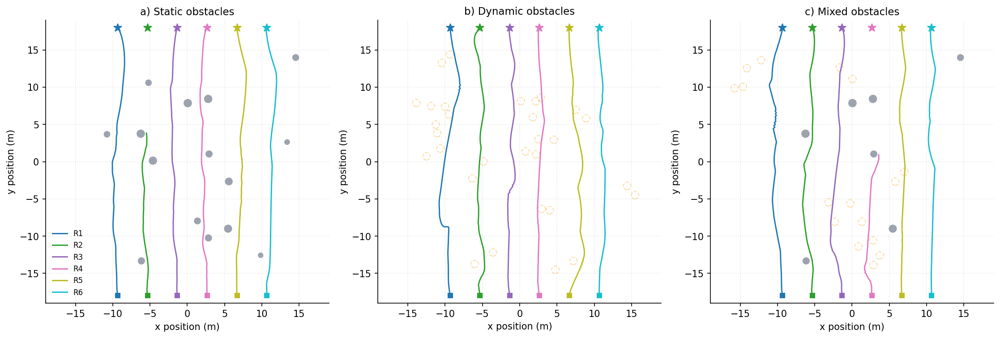
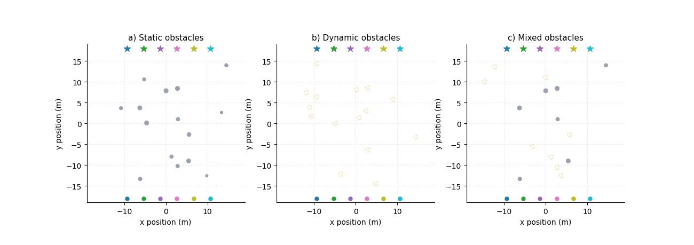
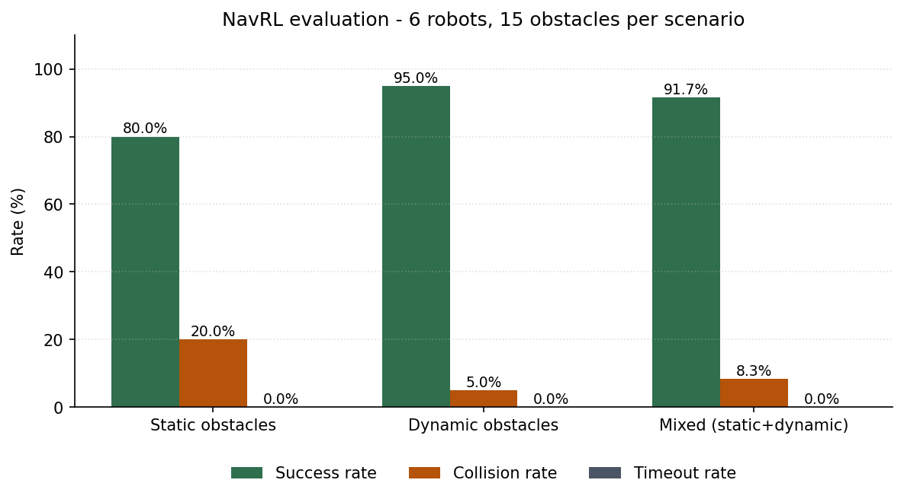
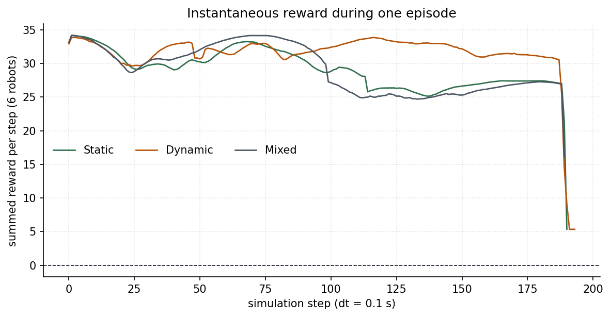

# NavRL-based Multi-Robot Navigation — Course Project

**Author:** GUO ZHINING (20263310)
**Course:** Machine Learning 6
**Date:** 11 Nov 2026

This project evaluates the released **pretrained NavRL** policy on 6 robots and
15 obstacles in three scenario types (static, dynamic, mixed). The checkpoint is
run for inference only on CPU; the network is **not retrained** in this project.

## 1. Scenarios

| Scenario | Obstacles | Composition | What it tests |
|---|---|---|---|
| Static | 15 static | 15 circles, radius 0.3–0.5 m, clearance ≥ 1.0 m, inside a 30 × 30 m field | Geometric avoidance in a dense field while staying on the goal direction |
| Dynamic | 15 dynamic | 15 circles, radius 0.5 m, speed 0.5–1.5 m/s, constant velocity with reflection at the boundary | Time-space reasoning: crossing traffic and prediction of other agents' motion |
| Mixed | 8 static + 7 dynamic | Both types together, 15 obstacles in total | Combined difficulty |

Robots start on a line at y = -18 m and their goals sit at y = +18 m (36 m trip).
Simulation step dt = 0.1 s, episode limit 350 steps (35 s), goal reached when
the distance to the goal is below 0.3 m.





*Demo: one episode per scenario, animated along the recorded trajectories. The
orange dashed circles mark the moving obstacles; stars are goals and squares
are the start positions.*

## 2. Reward functions

The reward is computed once per step in the NavRL environment
([`isaac-training/training/scripts/env.py`](https://github.com/Zhefan-Xu/NavRL/blob/main/isaac-training/training/scripts/env.py), lines 548–577):

```
r_t = R_vel + 1.0 + 1.0·R_static + 1.0·R_dyn - 0.1·P_smooth - 8.0·P_height
```

| Term | Formula | Code ([`env.py`](https://github.com/Zhefan-Xu/NavRL/blob/main/isaac-training/training/scripts/env.py)) | Range | When it is positive / negative |
|---|---|---|---|---|
| R_vel goal progress | v · (g - p) / ‖g - p‖ | `vel_direction = rpos / distance.clamp_min(1e-6)`; `reward_vel = (self.drone.vel_w[..., :3] * vel_direction).sum(-1)` (L557–558) | -2.0 … +2.0 (‖v‖ ≤ 2.0 m/s) | Positive when velocity points toward the goal, negative when it points away. |
| +1.0 alive bonus | constant +1 per step | `self.reward = reward_vel + 1. + …` (L575; the literal `1.` is the alive bonus) | +1 | Always positive; keeps the reward baseline above zero so every step of an unfinished episode is worth something. |
| R_static static safety | mean over beams of log(d) | `reward_safety_static = torch.log((self.lidar_range - self.lidar_scan).clamp(min=1e-6, max=self.lidar_range)).mean(dim=(2, 3))` (L549) | inner distance d ∈ [1e-6, 4.0] m, strictly > 0; log d ≤ log 4 ≈ +1.39; lower bound is governed by the 0.3 m collision radius | Positive (+1.39 = log 4) when every beam is clear; decreases logarithmically; becomes negative as the nearest surface grows close. |
| R_dyn dynamic safety | log(d_closest) | `reward_safety_dynamic = torch.log(closest_dyn_obs_distance_reward.clamp(min=1e-6, max=self.lidar_range)).mean(dim=-1, keepdim=True)` (L554) | inner distance d ∈ [1e-6, 4.0] m, strictly > 0; ≤ +1.39 | Same shape as R_static, but for the nearest moving agent/obstacle. |
| P_smooth action smoothness | ‖v_t - v_{t-1}‖, weight -0.1 | `penalty_smooth = (self.drone.vel_w[..., :3] - self.prev_drone_vel_w).norm(dim=-1)` (L561); applied as `- 0.1 * penalty_smooth` in `self.reward = …` (L575) | norm ≥ 0; contribution ≤ 0 | Only negative. Large velocity jumps are penalised; smooth control loses almost nothing. |
| P_height altitude | 8 · (exceedance of ±0.2 m outside the flight band)², weight -8.0 | `penalty_height = torch.zeros(...)`; `penalty_height[z > top+0.2] = (z - top - 0.2)²`; `penalty_height[z < bot-0.2] = (bot - 0.2 - z)²` (L564–566); applied as `- 8.0 * penalty_height` in `self.reward = …` (L575) | squared exceedance ≥ 0; contribution ≤ 0 | Only negative; 3-D (UAV) term. Inactive in the 2-D adaptation and set to 0. |

> **Note on the safety terms:** the distance passed to `torch.log` is clamped to
> `[1e-6, lidar_range]`, so its argument is always **strictly positive** — it is
> never zero or negative. The logged value itself can still be negative when the
> nearest surface is close; the clamp only protects the logarithm itself. The
> smoothness and height penalties are norms / squares, so their raw values are
> non-negative and only become non-positive after the negative weights are applied.

> **Where the code lives:** the quoted lines come from the upstream NavRL
> environment `env.py` (linked in the table header). This repository re-implements
> the same dense reward in `compute_reward()` of [`evaluate.py`](evaluate.py)
> (L93–112); the height penalty is inactive in the 2-D adaptation.

`R_g` (reach-goal +10), `R_c` (collision -0.5) and `R_to` (timeout -10) are
commented out / missing in this code base, so they contribute 0.00. The reward
is purely dense shaping: success, collision and timeout differ only in whether
the robot keeps collecting positive reward.

## 3. Evaluation protocol and metrics

**Protocol:** 10 episodes per scenario × 6 robots = **60 robot runs per scenario**
(180 in total), seeds 100–109, identical start/goal layout. A run ends at the
goal (success), on any collision (collision), or at the 350-step limit (timeout).
Collision radius: 0.3 m to an obstacle, 0.6 m robot-to-robot.

| Metric | Definition | Static | Dynamic | Mixed |
|---|---|---|---|---|
| Success rate | reached the goal before collision / timeout | 80.0 % | 95.0 % | 91.7 % |
| Collision rate | any collision during the run | 20.0 % | 5.0 % | 8.3 % |
| Timeout rate | 350 steps without reaching the goal | 0.0 % | 0.0 % | 0.0 % |
| Mean episode reward | sum over the 6 robots | 5323.6 | 5993.1 | 5842.4 |
| Mean reward per robot | episode reward / 6 | 887.3 | 998.8 | 973.7 |
| Mean minimum clearance (m) | closest surface distance over the run | 0.88 | 1.16 | 0.97 |
| Mean average speed (m/s) | mean commanded speed | 1.91 | 1.92 | 1.91 |
| Mean arrival step | simulation step at termination (× 0.1 s) | 168.7 | 187.1 | 183.0 |



### Per-term reward breakdown

Mean per-episode contribution per robot, averaged over 60 robot runs per
scenario. The five active shaping terms sum to the total reward per robot.
`R_g`, `R_c`, `R_to` are commented out and contribute 0.00; `P_height` is
inactive in the 2-D adaptation.

| Reward term | Static | Dynamic | Mixed |
|---|---|---|---|
| Total reward per robot (T_R) | 887.3 | 998.8 | 973.7 |
| R_vel goal progress | 318.4 | 352.0 | 344.1 |
| +1.0 alive bonus | 168.9 | 187.2 | 183.1 |
| R_static static safety | 229.9 | 255.6 | 249.9 |
| R_dyn dynamic safety | 171.0 | 206.0 | 198.2 |
| P_smooth smoothness penalty | -0.90 | -1.97 | -1.52 |
| P_height altitude | 0.00 | 0.00 | 0.00 |
| R_g reach-goal bonus | 0.00 | 0.00 | 0.00 |
| R_c collision penalty | 0.00 | 0.00 | 0.00 |
| R_to timeout penalty | 0.00 | 0.00 | 0.00 |



The gradual decline in the Static and Mixed curves reflects the safety
log-distance terms shrinking as robots close in on obstacles and one another;
the sharp drop at the end is the robots reaching the goal and leaving the
episode.

### Observations

- **Static obstacles are the weakest case (80 % success, 20 % collision).** The
  clusters are placed randomly with ≥ 1 m clearance, and several sit directly
  in the corridor; the policy was trained in a 3-D forest of thin trunks and
  its only wall signal is a 4 m lidar margin. Collisions concentrate exactly
  where the clearance is smallest (mean minimum clearance 0.88 m, lowest of the
  three).
- **Moving obstacles are handled better (95 % success, 5 % collision).** The
  0.5 m moving agents are seen earlier (larger and more isolated), and the
  dynamic branch of the network uses the 5-nearest-agent vector, so the policy
  reacts in time.
- **Mixed sits between the two (91.7 %).** Being close to the static score is
  expected, since the static half generates most of the failures.
- **Timeout is 0 % everywhere:** at about 1.9 m/s a 36 m crossing takes
  17–19 s, so the 35 s budget is never binding. The bottleneck is safety, not
  speed.
- **Reward tracks success but not enough:** the static scene still collects
  5323 points per episode although 20 % of the runs crash, confirming that a
  crash keeps most of its positive shaping reward.

## 4. Network and hyperparameters

The deployed policy is **PPO** with a convolutional + MLP feature extractor and
a Beta (continuous) actor.

**Observation (input) spaces**

| Key | Shape | Content |
|---|---|---|
| state | 8 | unit vector to the goal in the goal frame (3), 2-D distance to goal (1), z distance (1), velocity in the goal frame (3) |
| lidar | 1 × 36 × 4 | 36 horizontal beams at 10° (full 360°), 4 vertical beams spread over [-10°, 20°], range 4 m; value = r_max - d |
| direction | 1 × 3 | unit goal direction, used for the local-frame rotation of the actions |
| dynamic_obstacle | 1 × 5 × 10 | 5 nearest moving agents, 10 values each: unit relative position (3), 2-D distance (1), z distance (1), local velocity (3), width and height hints (2) |

**Network modules**

| Module | Architecture | Output |
|---|---|---|
| Lidar encoder | Conv2d 4 × (5,3) → ELU → Conv2d 16 × (5,3), stride (2,1) → ELU → Conv2d 16 × (5,3), stride (2,2) → ELU → flatten → Linear 128 → LayerNorm | 128 features |
| Dynamic-obstacle encoder | flatten 5 × 10 → MLP [128, 64] | 64 features |
| Fusion | concat(128 lidar, 8 state, 64 dynamic) = 200 → MLP [256, 256] | 256 features |
| Actor | Linear 1 → α, β → IndependentBeta → action in [0, 1]³ → 2a · a_limit - a_limit → rotate to the world frame | command (v_x, v_y), |v| ≤ 2.0 m/s |
| Critic | Linear 1 + ValueNorm | state value V(s) |

**Learning hyperparameters**

| Hyperparameter | Value | Note |
|---|---|---|
| Learning rate | 5e-4 | Adam, shared by extractor / actor / critic |
| Discount factor γ | 0.99 | |
| GAE λ | 0.95 | |
| PPO clip ratio | 0.1 | |
| Entropy coefficient | 1e-3 | encourage exploration |
| Action limit | 2.0 m/s | |
| Training frames per batch | 32 | |
| PPO epochs per batch | 4 | |
| Minibatches | 16 | |

### Note on training episodes

No reward curve over training episodes is reported: this assignment evaluates
the released pretrained checkpoint and does not retrain the network. The repo's
training configuration (`cfg/train.yaml`) schedules 1.2×10⁹ training frames
with 2 parallel envs and 2200 steps per episode — about 2.73×10⁵ episodes
equivalent under that config. The checkpoint stores network weights only, with
no episode or step counter, so the exact episode at which it was saved cannot
be read from the provided files.

## 5. Repository layout

```
navrl-multi-robot-navigation/
├── README.md            # this file
├── requirements.txt     # Python dependencies
├── evaluate.py         # evaluation runner (metrics, breakdown, figures)
├── scenarios.py         # static / dynamic / mixed scenario builders
├── tests/
│   └── check_metrics.py  # self-check over results/metrics.json
└── results/
    ├── metrics.json     # aggregated metrics and per-term breakdown
    ├── episodes.csv     # per-run outcomes
    ├── trajectories.png
    ├── metrics_bar.png
    ├── reward_curve.png
    └── demo.gif           # animated demo of one episode per scenario
```

## 6. Setup and run

### 6.1 Prerequisites

- Ubuntu 22.04 / WSL2, conda (Miniconda). CPU is sufficient for this
  inference-only evaluation; no Isaac Sim or GPU is required to reproduce the
  reported metrics.
- The upstream NavRL code base and its released pretrained checkpoint.

### 6.2 Get the code and environment

1. Clone the upstream NavRL repository:

```bash
git clone https://github.com/Zhefan-Xu/NavRL.git
cd NavRL
```

2. Create the deployment conda environment following the upstream instructions:

```bash
cd isaac-training
bash setup_deployment.sh
conda activate NavRL
```

3. Clone this course repository:

```bash
git clone https://github.com/guozhining03-boop/navrl-multi-robot-navigation.git
```

4. Place `evaluate.py` and `scenarios.py` under `NavRL/homework/` (the layout
   used for this project), or keep this repository's root and point the
   `sys.path` entry in `evaluate.py` to the upstream `quick-demos/` folder.

5. Put the released checkpoint at `quick-demos/ckpts/navrl_checkpoint.pt`.

### 6.3 Install this project's dependencies

```bash
conda activate NavRL
pip install -r requirements.txt
```

`requirements.txt` lists `numpy`, `matplotlib` and CPU `torch`; the remaining
NavRL runtime packages are installed by `setup_deployment.sh`.

### 6.4 Run the evaluation

```bash
cd NavRL/homework   # or this repository root if you adjusted the path
python evaluate.py --episodes 10 --steps 350
```

Outputs are written to `results/` (`metrics.json`, `episodes.csv`, the three
figures and the demo animation).

### 6.5 Run the self-check

```bash
python tests/check_metrics.py
```

The script verifies that success + collision + timeout rates sum to 1, that
60 robot runs were evaluated per scenario, and that the five active reward
terms sum to the mean reward per robot.

## 7. References

1. Z. Xu, X. Han, H. Shen, H. Jin, K. Shimada, "NavRL: Learning Safe Flight in
   Dynamic Environments," *IEEE Robotics and Automation Letters*, vol. 10,
   no. 4, pp. 3668–3675, 2025.
   [IEEE Xplore](https://ieeexplore.ieee.org/document/10904341) ·
   [arXiv preprint](https://arxiv.org/pdf/2409.15634) ·
   [demo video](https://youtu.be/EbeJW8-YlvI)
2. Upstream code base: [Zhefan-Xu/NavRL](https://github.com/Zhefan-Xu/NavRL)

```bibtex
@ARTICLE{NavRL,
  author={Xu, Zhefan and Han, Xinming and Shen, Haoyu and Jin, Hanyu and Shimada, Kenji},
  journal={IEEE Robotics and Automation Letters},
  title={NavRL: Learning Safe Flight in Dynamic Environments},
  year={2025},
  volume={10},
  number={4},
  pages={3668-3675},
  doi={10.1109/LRA.2025.3546069}
}
```
